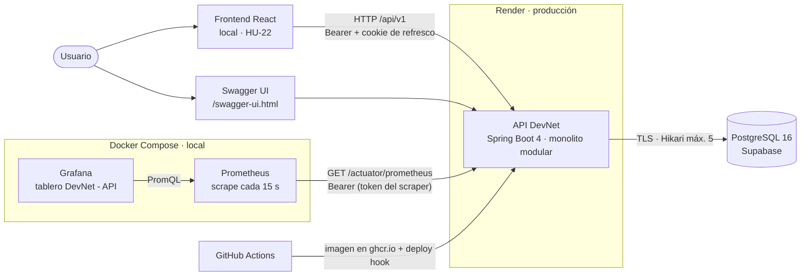

# Entregables de Arquitectura de Software — Sprint 3

Cumple §3.7 (Arquitectura de Software, sprint 3): *«Refinamiento de APIs; contenedores y
orquestación cuando aplique; observabilidad con Grafana/Prometheus; pruebas de integración;
aseguramiento mediante tokens»*. Video de la presentación:
<https://www.youtube.com/watch?v=jb-wZ4wa8JQ>

## 1. Resumen

| Entregable §3.7 | Qué se hizo | Evidencia | Estado |
|---|---|---|---|
| Refinamiento de APIs | 9 endpoints sin respuestas de error declaradas quedaron documentados (32 de 32 completos); el servidor ahora emite `AUTH_TOKEN_INVALIDO` como promete el ADR-005; `administration` suma 2 recursos | `apis-priorizadas.md`, `/v3/api-docs` | Hecho |
| Contenedores y orquestación | `docker-compose.yml` con perfiles (`app`, `observabilidad`); Kubernetes descartado con criterios para reabrirlo | [ADR-011](../adr/ADR-011-orquestacion-docker-compose-sin-kubernetes.md), `Dockerfile`, job `contenedores` del CI | Hecho |
| Observabilidad Grafana/Prometheus | `/actuator/prometheus` con histograma, token propio del scraper, tablero de 10 paneles y 5 alertas | [ADR-010](../adr/ADR-010-observabilidad-prometheus-grafana.md), `observabilidad/` | Hecho **en local**; producción *previsto* |
| Pruebas de integración | 22 clases `*IT` con PostgreSQL real (Testcontainers) y 32 unitarias; nueva `SeguridadTokensIT` | `src/test`, `./mvnw verify` | Hecho |
| Aseguramiento mediante tokens | Tabla de controles (§5) con prueba por cada uno; tokens vencidos, alterados y sin firma devuelven el cuerpo uniforme | `SeguridadTokensIT`, `FiltroMetricasTest` | Hecho; 3 brechas abiertas (§5) |
| Documentación al día (§4.4) | C4 nivel 2 y despliegue actualizados; ADR-010 a 012; README de arquitectura | `docs/arquitectura/`, `docs/adr/` | Hecho |

## 2. Historias del sprint y su efecto en la arquitectura

| HU | Qué entrega | Impacto arquitectónico |
|---|---|---|
| HU-19 | Reporte de actividad y crecimiento (solo ADMIN) | Módulo `administration` ([ADR-008](../adr/ADR-008-modulo-administration.md)); consolidación bajo demanda ([ADR-009](../adr/ADR-009-reporte-con-consolidacion-bajo-demanda.md)) |
| HU-20 | Consulta del registro de auditoría (solo ADMIN, solo lectura) | Triggers de V10 a V12; el registro lo escribe el sistema, nadie lo edita por la API |
| HU-21 | Logging estructurado con `traceId` | Logs JSON, `X-Trace-Id` en cada respuesta y error ([ADR-005](../adr/ADR-005-contrato-errores-traceid.md)) |
| HU-22 | Frontend (local, sin desplegar) | Aparece el contenedor «Cliente web»; condiciona la sesión ([ADR-012](../adr/ADR-012-frontend-react-local-y-codigo-en-discusiones.md)) |
| HU-23 | Valor agregado: insertar código en discusiones | El código se trata siempre como texto, nunca como HTML ([ADR-012](../adr/ADR-012-frontend-react-local-y-codigo-en-discusiones.md)) |

## 3. Vista de contenedores (sprint 3)



Los diagramas formales están en [`c4-02-contenedores.puml`](c4-02-contenedores.puml) y
[`uml-despliegue.puml`](uml-despliegue.puml).

## 4. Refinamiento de APIs

- **Contrato completo.** Todos los endpoints (32) declaran `@Operation` y sus respuestas. Faltaban
  `MensajeriaController`, `PerfilController` y `TecnologiaController` enteros, y `registrar`
  (auth), `listar` (discusiones) y `deAutor` (proyectos). Cumple RNF-09.
- **El cliente puede distinguir «sesión vencida» de «sin sesión».** El ADR-005 prometía
  `AUTH_TOKEN_INVALIDO` para un token inválido o vencido, pero el servidor respondía siempre
  `AUTH_REQUERIDA`, y para un token alterado respondía el 401 por defecto del resource server, **sin
  cuerpo ni `traceId`**. Ahora ambos salen por `ManejadorGlobalErrores`:

  | Situación | HTTP | `errorCode` | Qué hace el frontend |
  |---|---|---|---|
  | Sin token | 401 | `AUTH_REQUERIDA` | Ir al inicio de sesión |
  | Token vencido, alterado o sin firma | 401 | `AUTH_TOKEN_INVALIDO` | Un intento de `POST /auth/refresco`; si falla, inicio de sesión |
  | Token válido sin permiso | 403 | `ACCESO_DENEGADO` | Mostrar «sin permiso», sin reintentar |

- **Recursos nuevos del sprint:** `GET /api/v1/auditoria` (HU-20) y `GET /api/v1/reportes/actividad`
  (HU-19), ambos de solo lectura. Detalle en [`apis-priorizadas.md`](apis-priorizadas.md).
- **Pendiente, sin ocultarlo:** los listados de comentarios, seguidos y seguidores no paginan
  (hallazgo H-24), y el pipeline aún no exporta el contrato por versión ni falla si un endpoint nuevo
  no declara sus respuestas (pendiente del ADR-002).

## 5. Aseguramiento mediante tokens (§3.4 y §6.2)

| Control | Dónde vive | Prueba |
|---|---|---|
| Token de acceso de 15 min, firmado RS256; clave persistente obligatoria en producción | `JwtConfig`, `application-prod.yml` | `SeguridadTokensIT` (vencido, alterado, `alg=none`) |
| Refresco rotatorio, con detección de reuso y revocación de la familia | `RefrescarSesion`, ADR-004 | `RefrescoIT`, `RefrescarSesionTest` |
| Cookie de refresco `HttpOnly`, `Secure` y `SameSite=Strict` | `CookieRefresco` | `RefrescoIT` |
| El token de acceso no sirve como credencial de refresco | `SeguridadConfig` | `SeguridadTokensIT.token_de_acceso_no_refresca` |
| Mínimo privilegio: RBAC por endpoint (`@PreAuthorize`) y ABAC por propiedad | Controllers, dominio | `SeguridadTokensIT.token_valido_sin_permiso`, `ControlAccesoPorRolIT` |
| MFA para roles administrativos: sin inscribir, el token sale **sin permisos** | `Usuario.permisosEfectivos()` | `ControlAccesoPorRolIT` |
| Contraseñas con Argon2id y bloqueo tras 5 intentos fallidos por 15 min | `SeguridadConfig`, HU-03 | `InicioSesionIT` |
| El scraper de métricas usa su propio token, no el de un usuario | `FiltroMetricas`, ADR-010 | `FiltroMetricasTest` |
| Nunca se registran tokens, contraseñas ni cookies | `ManejadorGlobalErrores`, `FiltroTraceId` | `LoggingEstructuradoIT` |

**Brechas abiertas** (de [`owasp-top-10.md`](../seguridad/owasp-top-10.md); no se cerraron en este sprint):

- **H-01** — Un token de acceso ya emitido sigue siendo válido hasta que caduca (15 min) aunque la
  cuenta se suspenda; además no existe endpoint para suspender cuentas ni asignar roles.
- **H-12** — No hay limitación de tasa; el bloqueo por intentos permite bloquear cuentas ajenas.
- **H-14** — La inscripción de MFA no tiene endpoint: se activa por SQL.

## 6. Contenedores y observabilidad: cómo verlos funcionando

```bash
docker compose --profile observabilidad up -d --build
```

| Qué | Dónde | Qué comprobar |
|---|---|---|
| API | <http://localhost:8080/swagger-ui.html> | Ejecutar un par de operaciones |
| Prometheus | <http://localhost:9090> → *Status → Targets* | `devnet-api` en **UP** |
| Grafana | <http://localhost:3001> (admin / admin) → carpeta *DevNet* → *DevNet - API* | Tráfico, p95 por ruta, errores, 401/403, JVM, Hikari, caché |

Para ver el panel de seguridad moverse: pedir `GET /api/v1/auditoria` **sin** token (401) y con un
token de desarrollador (403). Las alertas están en `observabilidad/alertas.yml` y cada una apunta al
RNF que protege.

## 7. Pruebas de integración

`./mvnw verify` ejecuta Surefire (unitarias) y Failsafe (`*IT`, con PostgreSQL 16 real en
Testcontainers y las migraciones de Flyway aplicadas, sin H2). Requiere Docker.

| Módulo | Clases de integración |
|---|---|
| identity | `RegistroIT`, `InicioSesionIT`, `RefrescoIT`, `ControlAccesoPorRolIT`, **`SeguridadTokensIT`** (nueva) |
| profile | `PerfilIT`, `SeguimientoIT` |
| project | `PublicarProyectoIT`, `EditarProyectoIT`, `ArchivarProyectoIT`, `BuscarProyectosIT` |
| discussion | `CrearDiscusionIT`, `ListarDiscusionesIT` |
| interaction | `ComentarioIT`, `ReaccionIT` |
| messaging | `MensajeriaIT` |
| administration | `AuditoriaIT` (HU-20), `ReporteActividadIT` (HU-19) |
| transversales | `ErroresApiIT`, `LoggingEstructuradoIT` (HU-21), `EsquemaIT`, `BaseDatosSprint3IT` |

Además `FronterasModularesTest` (ArchUnit) impide que el código viole las fronteras del ADR-006, y
el pipeline falla si la cobertura baja del 65 % o no pasa el Quality Gate de SonarCloud.

## 8. Guion corto para mostrarlo

1. **Contrato:** Swagger UI → sección *Reportes* y *Auditoria* → mostrar las respuestas declaradas.
2. **Tokens:** pedir `/api/v1/conversaciones` sin token (401 `AUTH_REQUERIDA`), con un texto
   cualquiera (401 `AUTH_TOKEN_INVALIDO`) y con un token de desarrollador contra `/api/v1/auditoria`
   (403).
3. **Contenedores:** `docker compose --profile observabilidad up -d --build` y `docker compose ps`.
4. **Observabilidad:** Prometheus *Targets* en UP; Grafana con el tablero moviéndose.
5. **Pruebas:** `./mvnw verify` en verde, y el reporte de cobertura.
6. **Frontend (HU-22 y HU-23):** el flujo que muestra el video, y la inserción de código en una
   discusión.

## 9. Qué no está verificado todavía

Estos cambios se escribieron **sin poder compilar ni ejecutar** (no hubo acceso a Maven Central ni a
Docker en el entorno donde se prepararon). Se validó solo la sintaxis de los `.java`, y que los
`.yml` y el JSON del tablero sean válidos. Antes de integrar hay que correr `./mvnw verify` y el
`docker compose --profile observabilidad up`. Los riesgos concretos:

- Que `micrometer-registry-prometheus` quede alineado con Spring Boot 4.0.8 y publique el endpoint.
- Que `SeguridadTokensIT` y `ErroresApiIT` coincidan con el comportamiento real ante un token
  inválido (el ajuste en `SeguridadConfig` y `ManejadorGlobalErrores` es lo que lo hace posible).
- Que el tablero de Grafana muestre datos con los nombres de métricas que genera la versión instalada.
- Producción **no** se recolecta todavía (ADR-010, alternativa B).
- Los puntos **[CONFIRMAR]** del [ADR-012](../adr/ADR-012-frontend-react-local-y-codigo-en-discusiones.md)
  dependen de quien implementó HU-22 y HU-23.
