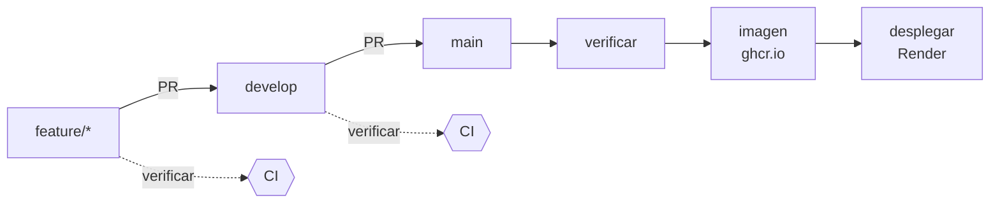

# Integración y despliegue continuos

Entregable de Arquitectura de Software del sprint 2 (§3.7: *«CI/CD inicial con GitHub
Actions»*). El pipeline está en
[`.github/workflows/ci.yml`](../.github/workflows/ci.yml).

## Flujo

| Evento | `verificar` | `imagen` | `desplegar` |
|---|:---:|:---:|:---:|
| Pull request hacia `develop` o `main` | ✅ | — | — |
| Push (merge) a `develop` | ✅ | — | — |
| Push (merge) a `main` | ✅ | ✅ si `verificar` pasa | ✅ si `imagen` pasa |

### `verificar` — compilar y probar

`./mvnw -B verify` con JDK 17, el mismo de la imagen de producción. Ejecuta:

- las pruebas **unitarias** (`*Test`, Surefire), incluidas las reglas de arquitectura de
  `FronterasModularesTest`;
- las pruebas de **integración** (`*IT`, Failsafe) contra un PostgreSQL 16 real levantado
  por Testcontainers con las migraciones de Flyway aplicadas (§3.5).

Si falla, los informes de Surefire y Failsafe quedan descargables en la ejecución como
artefacto `informes-de-pruebas` durante 7 días.

### `imagen` — artefacto versionado

Construye el `Dockerfile` y publica la imagen en
`ghcr.io/eap02/eap02-back` con dos etiquetas: el SHA del commit, inmutable, que dice
exactamente qué código es (§7.2, *«artefactos versionados… imágenes Docker
inmutables»*), y `latest`.

### `desplegar` — producción solo recibe lo que pasó el pipeline

Llama al *deploy hook* de Render. Corre en el entorno de GitHub `produccion`, que guarda
el secreto y deja el historial de despliegues en la pestaña **Environments** del
repositorio.

## Configuración que hay que hacer una vez

El pipeline no puede configurarse a sí mismo: estos pasos se hacen en los paneles de
GitHub y Render, con permisos de administrador del repositorio.

### 1. Render: que despliegue el pipeline, no cada push

1. Render → servicio **eap02-back** → **Settings** → **Build & Deploy**.
2. **Auto-Deploy** → `No` (u `Off`). Si se deja activado, Render desplegaría cada push a
   `main` **aunque las pruebas fallen**, y además dos veces: una por su cuenta y otra por
   el hook.
3. En la misma página, **Deploy Hook** → copiar la URL. Es secreta: quien la tenga puede
   desplegar.

### 2. GitHub: el entorno `produccion` y su secreto

1. Repositorio → **Settings** → **Environments** → **New environment** → `produccion`.
2. Dentro del entorno → **Add environment secret**:
   - Nombre: `RENDER_DEPLOY_HOOK`
   - Valor: la URL copiada de Render.
3. Opcional: en **Deployment branches**, limitarlo a `main`.

Si el secreto falta, el job `desplegar` falla con un mensaje que apunta a este documento,
en vez de terminar en verde sin haber desplegado.

### 3. GitHub: proteger las ramas

§7.1 pide *«una rama principal protegida»* y *«comprobaciones automáticas
obligatorias»*. Para `main` y para `develop`:

1. **Settings** → **Branches** → **Add branch ruleset** (o *Add rule*).
2. Activar:
   - **Require a pull request before merging**, con al menos 1 aprobación.
   - **Require status checks to pass** → añadir **`Compilar y probar`**. Solo aparece en
     la lista después de que el pipeline se haya ejecutado una vez.
   - **Block force pushes**.

Con esto ningún PR se puede integrar si las pruebas fallan, que es lo que exige §7.2:
*«la integración se bloquea si falla la compilación o las pruebas obligatorias»*.

## Lo que el pipeline todavía no hace

Queda fuera a propósito, porque pertenece a otro curso o a otro sprint:

| Control (§7.2) | Dónde corresponde |
|---|---|
| SonarCloud, Quality Gate y umbral de cobertura | Calidad de Software, sprint 2 |
| SAST, detección de secretos y análisis de imagen | Seguridad, a coordinar con Calidad |
| Smoke tests posdespliegue y métricas (Prometheus/Grafana) | Arquitectura, sprint 3 |
| Despliegue automático del entorno de integración desde `develop` | Cuando exista el segundo servicio de Render (§7.3) |

Añadir cualquiera de ellos es un job nuevo en el mismo archivo; no hace falta rehacer el
pipeline.
