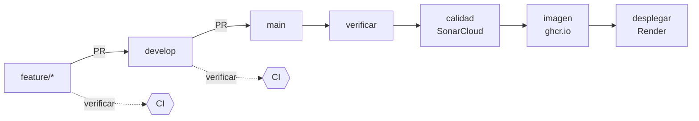

# Integración y despliegue continuos

Entregable de Arquitectura de Software del sprint 2 (§3.7: *«CI/CD inicial con GitHub
Actions»*). El pipeline está en
[`.github/workflows/ci.yml`](../.github/workflows/ci.yml).

## Flujo

| Evento | `verificar` | `calidad` | `imagen` | `desplegar` |
| --- | :---: | :---: | :---: | :---: |
| Pull request hacia `develop` o `main` | ✅ | ✅ si `verificar` pasa | — | — |
| Push (merge) a `develop` | ✅ | ✅ si `verificar` pasa | — | — |
| Push (merge) a `main` | ✅ | ✅ si `verificar` pasa | ✅ si `calidad` pasa | ✅ si `imagen` pasa |

### `verificar` — compilar y probar

`./mvnw -B verify` con JDK 17, el mismo de la imagen de producción. Ejecuta:

- las pruebas **unitarias** (`*Test`, Surefire), incluidas las reglas de arquitectura de
  `FronterasModularesTest`;
- las pruebas de **integración** (`*IT`, Failsafe) contra un PostgreSQL 16 real levantado
  por Testcontainers con las migraciones de Flyway aplicadas (§3.5).

Además mide la cobertura con JaCoCo. El agente se engancha a Surefire y a Failsafe, así que el informe suma pruebas unitarias y de integración. `jacoco:check` hace fallar el job si la cobertura de líneas baja del 65 % (RNF-05); el umbral es la propiedad `cobertura.minima` del `pom.xml`.

Si falla, los informes de Surefire y Failsafe quedan descargables en la ejecución como
artefacto `informes-de-pruebas` durante 7 días.

### `calidad`: Quality Gate de SonarCloud

Reutiliza los `.class` y el `jacoco.xml` que dejó `verificar` (no recompila ni repite las pruebas) y ejecuta `./mvnw sonar:sonar` con `sonar.qualitygate.wait=true`. El job espera el veredicto del Quality Gate y falla si no pasa, de modo que el PR queda bloqueado (RNF-05: *«Quality Gate de SonarCloud, bloqueante»*). En los PR, SonarCloud además comenta el resultado.

RNF-05 se traduce a SonarCloud en dos piezas, ambas creadas en el paso 4 de la configuración.

El Quality Gate `DevNet RNF-05` evalúa el **código nuevo** de cada PR:

| Condición (sobre código nuevo) | Valor |
| --- | --- |
| Coverage | ≥ 65 % |
| Maintainability Rating | A |
| Added Technical Debt (si la organización lo ofrece) | ≤ 960 min (2 días de 8 h) |
| Reliability Rating | A |
| Security Rating | A |
| Security Hotspots Reviewed | 100 % |
| Duplicated Lines | ≤ 3 % |

La complejidad ciclomática no es una condición posible de un Quality Gate. Se controla con el Quality Profile `DevNet Java`, que extiende *Sonar way* y activa la regla `java:S1541` (*Methods should not be too complex*) con umbral 50. Cada método que la supere genera un *code smell* que baja el Maintainability Rating y, con él, hace fallar el Quality Gate.

### `imagen` — artefacto versionado

Construye el `Dockerfile` y publica la imagen en
`ghcr.io/eap02/eap02-back` con dos etiquetas: el SHA del commit, inmutable, que dice
exactamente qué código es (§7.2, *«artefactos versionados… imágenes Docker
inmutables»*), y `latest`.

### `desplegar` — producción solo recibe lo que pasó el pipeline

Llama al *deploy hook* de Render. Corre en el entorno de GitHub `produccion`, que guarda
el secreto y deja el historial de despliegues en la pestaña **Environments** del
repositorio.

## Configuración que hay que hacer una vez

El pipeline no puede configurarse a sí mismo: estos pasos se hacen en los paneles de
GitHub, Render y SonarCloud, con permisos de administrador del repositorio.

### 1. Render: que despliegue el pipeline, no cada push

1. Render → servicio **eap02-back** → **Settings** → **Build & Deploy**.
2. **Auto-Deploy** → `No` (u `Off`). Si se deja activado, Render desplegaría cada push a
   `main` **aunque las pruebas fallen**, y además dos veces: una por su cuenta y otra por
   el hook.
3. En la misma página, **Deploy Hook** → copiar la URL. Es secreta: quien la tenga puede
   desplegar.

### 2. GitHub: el entorno `produccion` y su secreto

1. Repositorio → **Settings** → **Environments** → **New environment** → `produccion`.
2. Dentro del entorno → **Add environment secret**:
   - Nombre: `RENDER_DEPLOY_HOOK`
   - Valor: la URL copiada de Render.
3. Opcional: en **Deployment branches**, limitarlo a `main`.

Si el secreto falta, el job `desplegar` falla con un mensaje que apunta a este documento,
en vez de terminar en verde sin haber desplegado.

### 3. GitHub: proteger las ramas

§7.1 pide *«una rama principal protegida»* y *«comprobaciones automáticas
obligatorias»*. Para `main` y para `develop`:

1. **Settings** → **Branches** → **Add branch ruleset** (o *Add rule*).
2. Activar:
   - **Require a pull request before merging**, con al menos 1 aprobación.
   - **Require status checks to pass** → añadir **`Compilar y probar`** y **`Quality Gate SonarCloud`**. Solo aparecen en la lista después de que el pipeline se haya ejecutado una vez.
   - **Block force pushes**.

Con esto ningún PR se puede integrar si las pruebas fallan, que es lo que exige §7.2:
*«la integración se bloquea si falla la compilación o las pruebas obligatorias»*.

### 4. SonarCloud: proyecto, token y Quality Gate

1. Entrar a [sonarcloud.io](https://sonarcloud.io) con la cuenta de GitHub.
2. **+** → **Analyze new project** → importar la organización de GitHub `EAP02` (si no existe aún en SonarCloud, **Import an organization**, plan *Free*, que aplica porque el repositorio es público).
3. Seleccionar `EAP02-Back` → **Set Up**. En *new code* elegir **Previous version** o **Number of days = 30**.
4. Comprobar que la *organization key* sea `eap02` y la *project key* `EAP02_EAP02-Back` (**Information** del proyecto). Si son otras, corregir `sonar.organization` y `sonar.projectKey` en el `pom.xml`.
5. **Administration** → **Analysis Method** → desactivar **Automatic Analysis**. Si queda activo, el análisis desde Maven falla con *«You are running CI analysis while Automatic Analysis is enabled»*.
6. **My Account** → **Security** → **Generate Tokens**: nombre `github-actions-eap02-back`, tipo *Project Analysis Token*, proyecto `EAP02-Back`. Copiar el valor.
7. En GitHub: repositorio → **Settings** → **Secrets and variables** → **Actions** → **New repository secret**, nombre `SONAR_TOKEN`, valor el token copiado.
8. En SonarCloud: organización → **Quality Gates** → **Create** `DevNet RNF-05` con las condiciones de la tabla de la sección `calidad`, y luego **Set as Default** (o asignarlo solo al proyecto en **Administration** → **Quality Gate**).
9. Organización → **Quality Profiles** → Java → *Sonar way* → **Extend**, nombre `DevNet Java`. En el perfil nuevo, **Activate More** → buscar `S1541` → activar con *Threshold* = `50`. Luego **Set as Default** para Java.
10. Volver a lanzar el pipeline (pestaña **Actions** → **Run workflow**) y añadir **`Quality Gate SonarCloud`** como check obligatorio (paso 3).

Si el secreto falta, el job `calidad` falla con un mensaje que apunta a este documento.

## Lo que el pipeline todavía no hace

Queda fuera a propósito, porque pertenece a otro curso o a otro sprint:

| Control (§7.2) | Dónde corresponde |
| --- | --- |
| SAST, detección de secretos y análisis de imagen | Seguridad, a coordinar con Calidad |
| Smoke tests posdespliegue y métricas (Prometheus/Grafana) | Arquitectura, sprint 3 |
| Despliegue automático del entorno de integración desde `develop` | Cuando exista el segundo servicio de Render (§7.3) |

Añadir cualquiera de ellos es un job nuevo en el mismo archivo; no hace falta rehacer el
pipeline.
